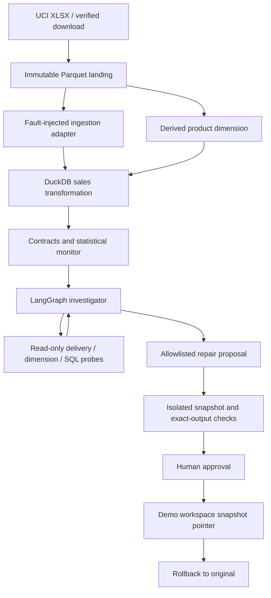

# FlowCheck

## Agentic AI for Data Pipeline Monitoring, Fault Diagnosis, and Verified Repair

**Python · LangGraph · DuckDB · FastAPI · Ollama · Isolation Forest**

Built for an interview walkthrough and reproducible experiments. The UI is a working local application, backed by DuckDB, FastAPI, LangGraph, a trained Isolation Forest, and persistent run history. It is not a mock dashboard.

## Quick start

Python 3.12 is recommended. From this directory:

```bash
make setup
make data
make run
```

Open **http://127.0.0.1:8765**. On this prepared Mac, you can also double-click `Start-PipelineMedic.command`. Do not open `index.html` directly; the dashboard requires the API. The first overview loads the dataset and fits the small detector; later requests reuse the cached model. The current workspace already has the data and virtual environment prepared, so `make run` is sufficient.

```bash
make test       # automated unit/integration tests, coverage, JUnit
make benchmark  # 120 controlled cases on 12 held-out batch dates
make report    # regenerates PDF + Markdown from measured artifacts
make lint
```

Dependencies are pinned in `requirements.lock.txt`. Keep `data/`, `.tools/`, `.venv/`, and runtime snapshots out of Git. The original archive checksum is verified by the ingestion script. Dataset download requires internet once; the offline demonstration does not.

## Five-minute demonstration

1. Choose **Join fan-out**, batch **2011-10-05**, seed **42**, affected fraction **30%**.
2. Run an offline investigation. Explain that the SQL succeeds but multiplies rows.
3. Open **Evidence trace**. The dimension has duplicate keys; delivery and approved SQL are intact.
4. Open **Repair & review**. The proposed exact-row deduplication restores 2,447 fact rows and GBP 75,244.43, down from 3,183 rows and GBP 99,330.93 in this controlled incident.
5. Approve the demo repair, inspect the audit log, and roll it back.
6. Run **Genuine business change**. Source data changed consistently, so no repair is proposed.
7. Open **Evaluation**. Discuss why statistical novelty performs poorly as a detector of structural corruption and why strong contracts matter.

Full explanation, research methods, interview questions, three project talking points, and one measured Google XYZ resume bullet are in `docs/PipelineMedic-Report.pdf` and `docs/REPORT.md`.

## Real data, controlled faults

[UCI Online Retail](https://archive.ics.uci.edu/dataset/352/online+retail) contains 541,909 transaction rows, covering 2010-12-01 through 2011-12-09. Citation: Chen, D. (2015). Online Retail. UCI Machine Learning Repository. https://doi.org/10.24432/C5BW33. License: CC BY 4.0.

All rows are retained, including 135,080 missing customer IDs and 10,624 negative quantities. Each original spreadsheet row gets a stable positional `source_row_id`. That provenance key is different from a transaction business key: two identical purchases with different source IDs remain separate.

The dimension is derived from the selected batch for the fault laboratory, not presented as a separate observed UCI table. The immutable landing batch, damaged ingestion, product dimension, fact transformation, and aggregate metrics form a small relational pipeline. Fault labels and evaluation answers are never supplied to the investigator.

The ten scenarios are healthy data, retry duplication, incomplete delivery, null-field corruption, price scaling, join fan-out, SQL filtering regression, schema rename, genuine source change, and compound duplication plus fan-out. The missing-partition scenario drops a subset of a daily delivery, not an entire date. Synthetic business changes are test controls, not claims about historical events.

## Architecture



FastAPI serves the vanilla JavaScript/CSS UI. SQLite WAL stores durable run records and audit events. Each run has independent Parquet snapshots. LangGraph controls the bounded decision/probe loop. Docker and CI configuration are included. This version uses an explicit, auditable SQL pipeline rather than claiming dbt/Dagster integrations it does not implement.

## AI modes

- **Offline:** deterministic evidence policy in LangGraph. Reproducible and suitable for an internet-free interview. It still uses the statistical ML detector, but the investigator itself is not a language model.
- **Ollama:** a real local LLM chooses the order of read-only tools and produces a structured diagnosis and repair proposal. JSON schema constrains tool selection; the server separately authorizes evidence-supported repair actions. Provider errors stop safely, with no hidden fallback to the offline policy.

Install [Ollama](https://ollama.com/) using its official distribution, then:

```bash
ollama serve
ollama pull qwen2.5:7b
# In another terminal, start the app and choose Live LLM in the UI.
make run
```

The current workspace also contains a project-local runtime and downloaded model. To start that runtime without a system-wide installation:

```bash
OLLAMA_MODELS="$PWD/.tools/models" .tools/ollama serve
```

Environment variables `OLLAMA_BASE_URL` and `OLLAMA_MODEL` override the defaults. `.env.example` documents them; the app reads process environment variables and does not automatically load `.env`. Use `export` or a process manager. Test a live model separately with `python scripts/live_smoke.py`; never attribute offline benchmark scores to the LLM.

## Evaluation protocol

- Training batches: through July 31, 2011.
- Calibration batches: August 2011.
- Held-out benchmark batches: September-November 2011.
- Features: row count, absolute revenue, mean price, mean absolute quantity, missing customer rate, return rate.
- Isolation Forest: 150 trees, fixed random seed, log-transformed nonnegative features.
- A calibration tail fraction ranks anomaly scores against August. It is descriptive; temporal exchangeability is not assumed and it is not a calibrated corruption probability.
- Statistical baseline: robust median absolute deviation (threshold 6).
- Contract baseline: schema, source identities, delivery completeness, value fidelity, dimension keys, execution, and fact conservation.
- Repairs: full-output fingerprints compare all fields, identities, and multiplicities to an evaluator-only reference built from the trusted source and versioned SQL.

Known failure families on new dates/seeds do **not** demonstrate generalization to unseen failure types. The source and approved transform make this benchmark unusually diagnosable. Perfect controlled-case results are not a production SLA. Clean/genuine-shift cases are negative for *corruption*, even when a novelty alert is reasonable. Repair actions restore run-local data/model snapshots; they do not deploy upstream application-code fixes.

## Operational boundaries

- Bind to localhost. This is a single-user, single-process application; use one Uvicorn worker.
- Six queued/running jobs maximum, two workers, UUID run isolation, idempotent creation keys, and guarded approval transitions.
- Interrupted runs are marked explicitly on restart. Completed snapshots and history persist. Mid-tool resumption is not implemented.
- No arbitrary SQL or Python generated by the model is executed. Allowlisted Python repair functions operate on copied data. This is logical data isolation, not a security boundary for arbitrary code execution.
- The source is trusted. Malicious filesystem modifications or bad upstream source truth are outside this benchmark.
- Optional `PIPELINEMEDIC_TOKEN` protects API routes for API clients. The browser UI does not include a login flow. Do not expose the app publicly without adding TLS, user authentication/authorization, managed storage, distributed jobs, secrets management, retention, and load testing.
- Model output is rendered as text; strict CSP, host checks, and same-origin mutation checks are enabled.
- No personal resume data is included in the application or dataset.

## Container

```bash
make data
docker compose up --build
```

The port is bound to the host loopback interface. Data is mounted read-only. Audit/run artifacts use a writable volume. The process runs as a non-root user. On Linux, give UID 10001 ownership of the artifact directory before running the container. Actual container execution status is documented in the report; configuration alone is not a deployment verification.

## API

- `GET /api/health`, `GET /api/overview`
- `POST /api/runs` with `{ "scenario": "join_fanout", "date": "2011-10-05", "seed": 42, "severity": 0.3, "mode": "offline" }`
- `GET /api/runs`, `GET /api/runs/{id}`
- `POST /api/runs/{id}/approve`, `POST /api/runs/{id}/rollback`
- `GET /api/runs/{id}/export`, `GET /api/benchmark`, `GET /api/report`

`POST /api/runs` returns 202 and a UUID; poll the run route. Optional `Idempotency-Key` protects retries. Conflicting reuse returns 409; queue saturation returns 429. The machine-readable OpenAPI schema is at `/openapi.json`. The strict content security policy does not permit the CDN scripts used by the default interactive documentation.

## Repository map

- `src/pipelinemedic/pipeline.py`: data access, lineage, fault injection, SQL, snapshots, repair recipes.
- `detection.py`: temporal data-science pipeline and contracts.
- `agent.py`: LangGraph, read-only probes, deterministic and live-model policies.
- `service.py`: job lifecycle, independent validation, persistence, approval/rollback.
- `api.py`: validated API and local security controls.
- `static/`: fully local UI, no CDN dependency.
- `scripts/`: ingestion, benchmarks, live integration sample, report generation.
- `tests/`: unit, integration, fault, and safety tests.
- `artifacts/`: measured evaluation evidence; run-local snapshots are ignored by Git.

Software is MIT licensed; data retains its separate CC BY 4.0 attribution.
